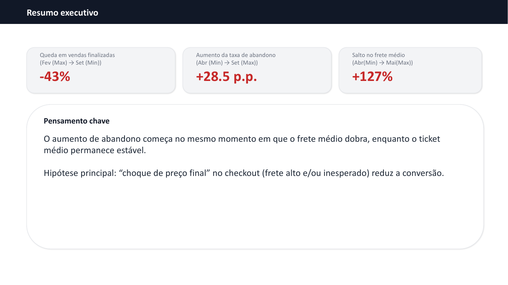
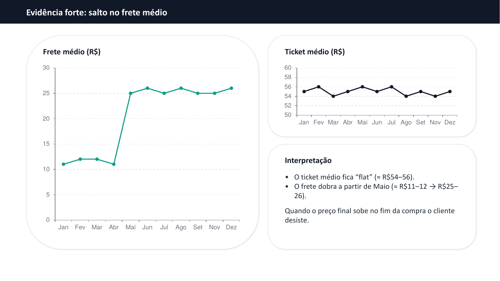

# Abandono de carrinho: diagnóstico e plano de ação

Projeto do curso **Profissão: Cientista de Dados (EBAC)**, Módulo 11.

Apresentação em formato de storytelling com dados que investiga por que as compras finalizadas de um e-commerce caíram ao longo do ano e propõe um projeto de machine learning para reduzir o abandono de carrinho.

**Autor:** Lucas Farias Epitácio de Almeida

📄 **[Ver a apresentação completa (PDF)](Abandono_de_Carrinho_Diagnostico_e_Plano_de_Acao.pdf)**

## Resumo

| Indicador | Variação |
| --- | --- |
| Vendas finalizadas (fevereiro → setembro) | −43% |
| Taxa de abandono (abril → setembro) | +28,5 pontos percentuais |
| Frete médio (abril → maio) | +127% |
| Ticket médio | estável, entre R$ 54 e R$ 56 |



## A história

**Cenário.** Até abril o funil estava saudável: mais de 100 vendas por mês e abandono entre 8% e 11%.

**Complicação.** Em maio o frete médio dobra, de cerca de R$ 11–12 para R$ 25–26, enquanto o ticket médio continua o mesmo. A partir daí as vendas caem e o abandono cresce mês a mês, até um pico de cerca de 37% em setembro.

**Hipótese.** O cliente desiste quando vê o preço final no checkout. O frete passou a representar quase metade do valor dos produtos, e essa surpresa no fim da compra derruba a conversão.



## Resolução: o que fazer

**Ações imediatas, sem depender de modelo:**
- Mostrar o frete estimado já na página do produto ou no carrinho, para eliminar a surpresa no checkout.
- Testar frete grátis acima de um valor mínimo de compra, próximo ao ticket médio atual.
- Rodar um teste A/B de política de frete para confirmar se o frete é de fato a causa.

**Projeto de machine learning:** um modelo que estima a probabilidade de abandono de cada sessão a partir de canal, dispositivo, itens, valor do frete, tempo no site, etapa do checkout e histórico do cliente. Com essa pontuação, cupons e comunicações vão só para quem está em risco, em vez de para todo mundo.

## Métricas do modelo

A apresentação cita acurácia de 90% e recall de 85%. Para este problema, o **recall é a métrica que importa**: de cada 100 clientes que abandonariam, cerca de 85 são detectados a tempo.

A acurácia sozinha engana aqui. Como a maioria dos carrinhos não é abandonada, um modelo que sempre previsse "não vai abandonar" já teria acurácia alta sem detectar ninguém. O próximo passo seria medir também a **precisão**, para saber quantos cupons iriam para clientes que comprariam de qualquer jeito.

## Limitações

- **Outubro não aparece nos gráficos**, que pulam de setembro para novembro. É uma lacuna na série de dados.
- **Correlação no tempo não prova causa.** Outros fatores podem ter mudado em maio (transportadora, site, campanhas). Por isso a hipótese do frete precisa ser confirmada com o teste A/B proposto acima.

## Estrutura

```
├── Abandono_de_Carrinho_Diagnostico_e_Plano_de_Acao.pdf   # apresentação completa (6 slides)
└── imagens/                                              # prévias de slides usadas neste README
```
